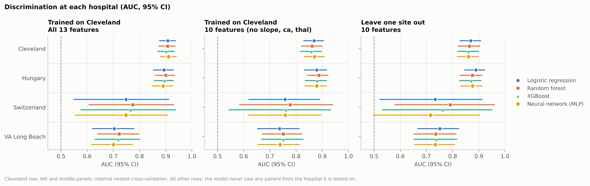
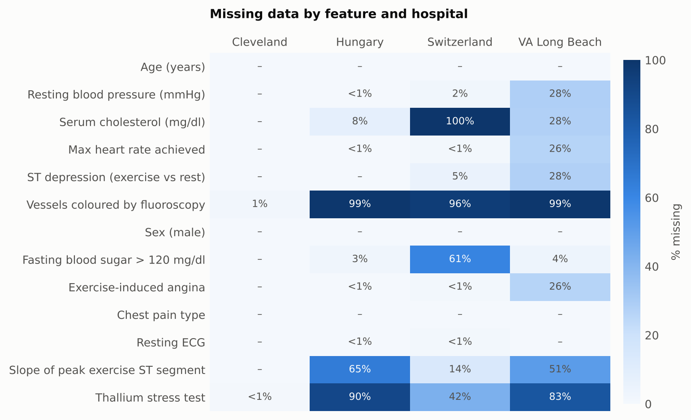
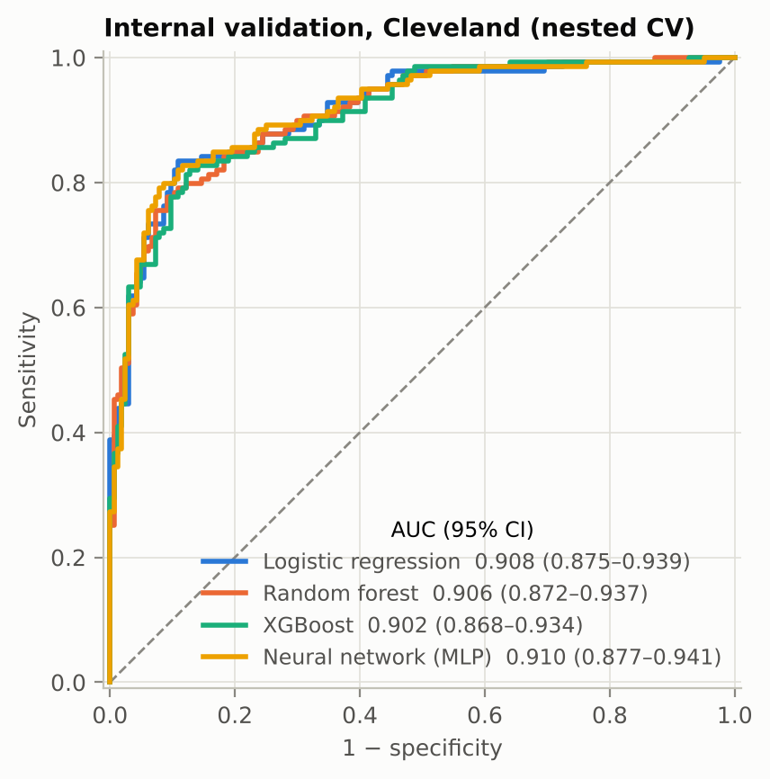
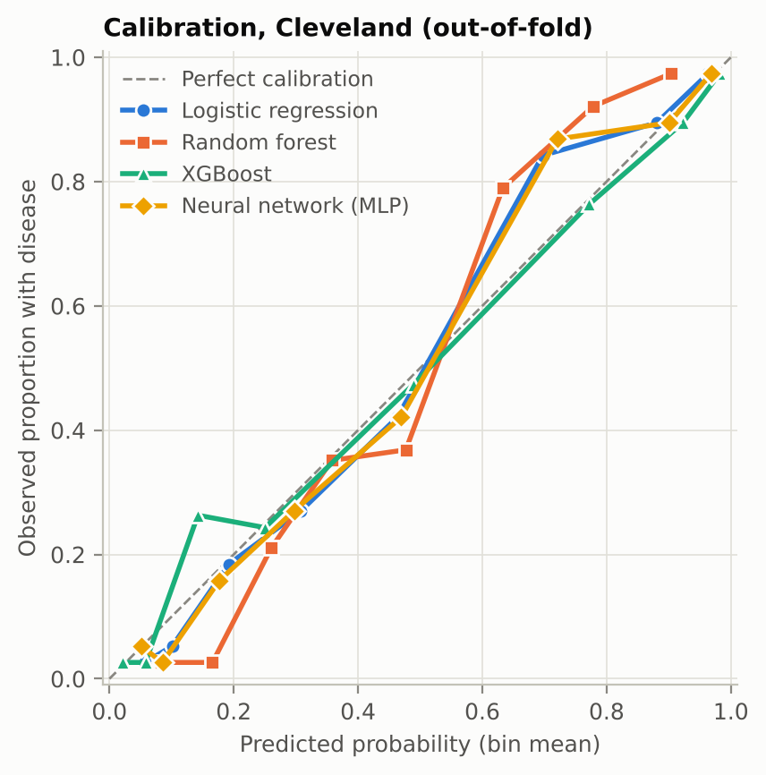
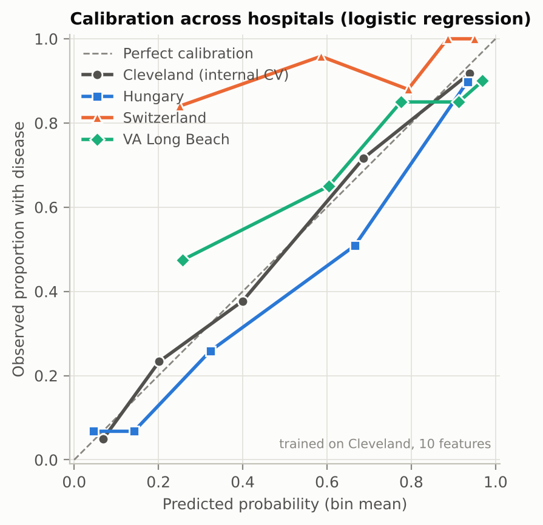
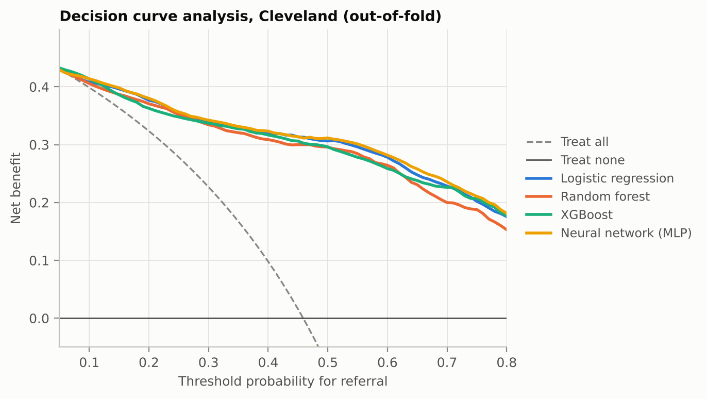
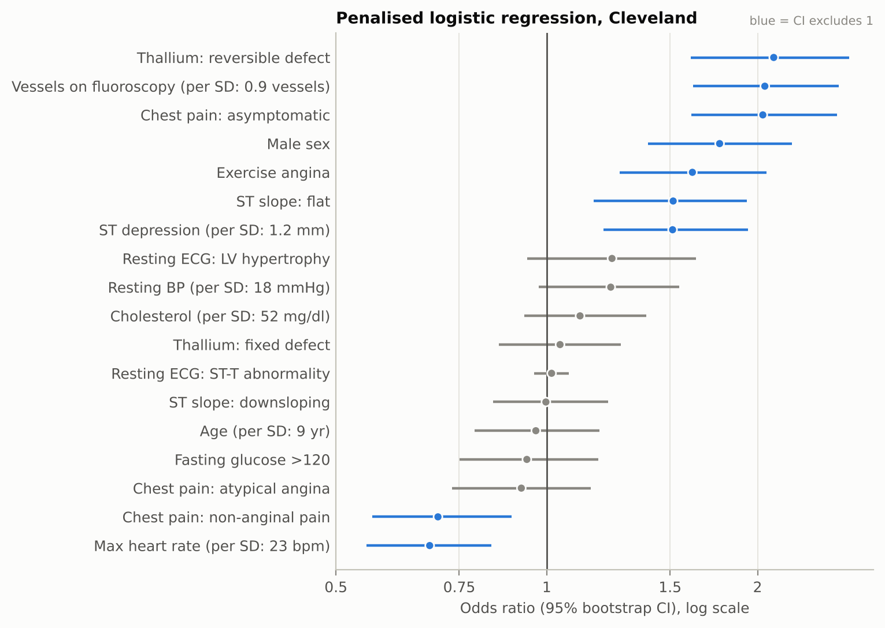

# Does a heart disease model travel? Multi-centre validation on the UCI Heart Disease data

[](https://github.com/anupbagale/Heart_disease_prediction/actions/workflows/ci.yml)
[](https://colab.research.google.com/github/anupbagale/Heart_disease_prediction/blob/main/notebooks/heart_disease_analysis.ipynb)

Most machine-learning work on the UCI Heart Disease dataset trains and tests on
the Cleveland cohort alone and reports an AUC near 0.9. But the dataset holds
patients from **four hospitals** in three countries. This project asks what
happens when a model built at one hospital is used at another, and why.

**Technical report:** [`docs/report.md`](docs/report.md) ·
**Walkthrough notebook:** [`notebooks/heart_disease_analysis.ipynb`](notebooks/heart_disease_analysis.ipynb)

## Key findings

1. **On Cleveland, simple is as good as complex.** With nested, repeated
   cross-validation, logistic regression, random forest, XGBoost and a neural
   network all reach AUC 0.90–0.91. No flexible model beats logistic regression
   (paired AUC differences between −0.006 and +0.002, every 95% CI includes 0).
2. **Discrimination drops at other hospitals.** A model trained on Cleveland
   reaches AUC 0.88 in Hungary but only about 0.75 in Switzerland and 0.70–0.75
   at VA Long Beach. This holds for all four model types.
3. **Calibration fails more than discrimination.** Disease prevalence ranges
   from 36% (Hungary) to 94% (Switzerland). A model's risk estimates carry over
   the prevalence of the hospital it learned from: in Switzerland the
   Cleveland logistic regression (10 features) predicts an average risk of 69%
   where 94% of patients have disease. Any real deployment would need local recalibration.
4. **More features made the model worse.** Three tests are largely missing
   outside Cleveland (`ca` 96–99%, `thal` 42–90%, `slope` 14–65%). Filling them with Cleveland's typical
   values makes a sick VA patient look healthy: the 13-feature model detects
   only **48%** of VA patients with disease, against **85%** for a 10-feature
   model that leaves those tests out.



## Data

The [UCI Heart Disease dataset](https://doi.org/10.24432/C52P4X) (Janosi et al., 1989; CC BY 4.0):
920 patients referred for coronary angiography. The outcome is angiographic
coronary artery disease (> 50 % narrowing in any major vessel, `num > 0`).

| | Cleveland | Hungary | Switzerland | VA Long Beach |
|---|---|---|---|---|
| Patients | 303 | 294 | 123 | 200 |
| Disease prevalence | 45.9% | 36.1% | 93.5% | 74.5% |
| Age, mean (SD) | 54.4 (9.0) | 47.8 (7.8) | 55.3 (9.0) | 59.4 (7.8) |
| Male | 68.0% | 72.4% | 91.9% | 97.0% |
| Asymptomatic chest pain | 47.5% | 41.8% | 79.7% | 65.5% |

Thirteen predictors: age, sex, chest-pain type, resting blood pressure,
cholesterol, fasting blood sugar, resting ECG, maximum heart rate, exercise
angina, ST depression, ST slope, vessels on fluoroscopy (`ca`) and thallium
stress test (`thal`). See [`data/README.md`](data/README.md) for codes, provenance and cleaning.



## Methods

* **Outcome:** `num > 0` (disease present), as in the original studies.
* **Preprocessing inside the model:** median imputation and standardisation for
  numeric features, most-frequent imputation for binary features, most-frequent
  imputation and one-hot encoding for categorical features. All of it lives in an
  sklearn `Pipeline`, so it learns only from training data.
* **Models:** L2-penalised logistic regression, random forest, XGBoost, and a
  multilayer perceptron, each with a small hyperparameter grid.
* **Internal validation (Cleveland):** nested cross-validation: 3-fold inner
  search, 5-fold outer, outer loop repeated 10 times (50 outer folds per model).
* **External validation:** tune and train on all of Cleveland, test unchanged at
  Hungary, Switzerland and VA Long Beach, with all 13 features and with 10
  features (dropping `slope`, `ca`, `thal`).
* **Leave-one-site-out:** train on three hospitals, test on the fourth (10 features).
* **Metrics:** AUC, sensitivity and specificity at a 0.5 threshold, Brier score,
  calibration intercept and slope, decision-curve net benefit. 95% CIs from
  2,000 stratified bootstrap resamples of the test patients; model comparisons use a paired bootstrap.
* **Interpretability:** odds ratios with bootstrap CIs from logistic regression; SHAP values from XGBoost.
* **Subgroups:** performance for women and men separately.
* **Reporting:** organised around the [TRIPOD+AI](https://www.bmj.com/content/385/bmj-2023-078378) checklist (see the report's appendix).

## Results

### Internal validation, Cleveland (13 features)

| Model | AUC (95% CI) | Sensitivity | Specificity | Brier | Calibration slope |
|---|---|---|---|---|---|
| Logistic regression | 0.908 (0.875–0.939) | 0.785 | 0.901 | 0.119 | 1.16 |
| Random forest | 0.906 (0.872–0.937) | 0.781 | 0.884 | 0.129 | 1.68 |
| XGBoost | 0.902 (0.868–0.934) | 0.796 | 0.873 | 0.124 | 0.85 |
| Neural network (MLP) | 0.910 (0.877–0.941) | 0.796 | 0.901 | 0.117 | 1.11 |

Every model is well calibrated in the large (intercepts within ±0.04). The random forest's
slope of 1.68 means its probabilities are too cautious (squeezed toward the middle), a known
property of averaging many trees.

<p>


</p>

### External validation (logistic regression, trained on Cleveland)

| Test hospital | Features | AUC (95% CI) | Sensitivity | Calibration intercept | Brier |
|---|---|---|---|---|---|
| Hungary | 13 | 0.894 (0.851–0.930) | 0.585 | +0.45 | 0.133 |
| | 10 | 0.878 (0.830–0.917) | 0.783 | −0.50 | 0.133 |
| Switzerland | 13 | 0.748 (0.548–0.913) | 0.522 | +3.21 | 0.272 |
| | 10 | 0.758 (0.618–0.892) | 0.774 | +2.60 | 0.160 |
| VA Long Beach | 13 | 0.703 (0.618–0.780) | 0.483 | +1.78 | 0.288 |
| | 10 | 0.737 (0.651–0.813) | 0.852 | +0.31 | 0.174 |

A positive calibration intercept means the model *under*-predicts risk. The other three
models show the same pattern; full tables for every model and metric are in
[`results/tables/`](results/tables).



**Why the 13-feature model fails.** The vessel count `ca` is the strongest
predictor at Cleveland, and a value of 0 strongly suggests no disease. At VA, 99%
of patients have no `ca` recorded, so the imputer fills in Cleveland's median, which is 0.
Every VA patient therefore enters the model looking like a low-risk Cleveland patient. The model still ranks
patients reasonably (AUC 0.70), but its average predicted risk is 42% for a
population where 75% have disease, and it misses half of them. Dropping the
three tests that the other hospitals rarely measured costs some internal AUC (0.908 → 0.868)
but gives a model that transfers better. The general lesson is that a feature only
helps if it will actually be measured where the model is used.

**Pooling hospitals helps a little.** Training on three hospitals and testing on the fourth
gives AUC 0.869 (Cleveland), 0.888 (Hungary), 0.733 (Switzerland) and 0.751 (VA).
At VA, calibration-in-the-large improves (intercept +0.09), but Hungary is now over-predicted
(−0.99) because the training data are dominated by high-prevalence sites.
Calibration follows the training population.

### Clinical usefulness, interpretation and subgroups

<p>


</p>

* **Decision curves:** at Cleveland, using any of the models to decide on referral gives more
  net benefit than referring everyone at every threshold probability above about 7%, and the
  advantage grows as the threshold rises.
* **What drives risk:** reversible thallium defect, number of vessels on fluoroscopy and
  asymptomatic chest pain roughly double the odds of disease. Male sex, exercise angina,
  a flat ST slope and ST depression also raise them. A higher maximum heart rate and non-anginal
  chest pain lower them. Age and cholesterol add little once these are known.
  SHAP values from XGBoost rank the same features at the top ([figure](results/figures/shap_xgboost.png)).
* **Sex:** AUC is similar for women (0.915) and men (0.889). At the same 0.5 threshold,
  sensitivity is lower for women (0.72 vs 0.80) and specificity higher (0.97 vs 0.85),
  reflecting the lower prevalence in women (26% vs 55%). The confidence intervals are wide
  with 97 women ([figure](results/figures/subgroup_sex.png)).

## Limitations

* Small cohorts. Switzerland has only 8 patients without disease, so its
  specificity and calibration estimates are very uncertain.
* The data were collected in the 1980s, from patients already referred for angiography.
  They do not represent today's patients or a screening population.
* Missing data were handled by simple imputation. Methods that model the
  missingness, or site-specific recalibration, are natural next steps.
* Bootstrap CIs capture the variability of the test patients, not of model refitting.
* The categorical one-hot encoding and the 0.5 threshold are conventional choices, not tuned clinically.

## Reproduce

**In the browser, no install:** click the *Open in Colab* badge at the top and run
the first cell. The notebook downloads this repository, shows every result, and its last
section re-runs the whole analysis (quick mode ~7 min, full mode ~20 min).

**Locally:**

```bash
git clone https://github.com/anupbagale/Heart_disease_prediction
cd Heart_disease_prediction
pip install -r requirements.txt && pip install -e .

pytest -q                                  # 18 tests, ~3 min
python scripts/run_experiments.py          # all tables and figures, ~20 min on 2 CPUs
python scripts/run_experiments.py --quick  # smoke test, ~7 min
python scripts/download_data.py --check    # verify data/raw against UCI
```

Results in `results/` were produced with Python 3.13 and the versions in
`requirements.txt` (see `results/run_info.json`). All random seeds are fixed.

## Repository layout

```
data/raw/                 four cohorts as CSV (UCI codes), with data/README.md
src/heartdisease/         data loading, model pipelines, metrics, figures
scripts/run_experiments.py  every analysis in one command
scripts/download_data.py  re-create or check the data against UCI
notebooks/                narrated walkthrough (opens in Colab)
results/tables, figures   outputs used in this README and the report
results/predictions/      out-of-fold and external predictions for every model
tests/                    data integrity, leakage and metric tests
docs/report.md            technical report with TRIPOD+AI checklist
```

## Version history

**v1 (July 2024)** was a single Colab notebook ([commit 9ae57f5](https://github.com/anupbagale/Heart_disease_prediction/tree/9ae57f5)).
Reviewing it revealed a serious bug: the network used a binary loss on the 0–4
`num` column, so the loss went negative (about −1887) and test accuracy (55.7%)
was no better than always predicting "no disease" (54.1%). The imputer was also
fitted before the train/test split. **v2** fixes these problems and turns the
project into the multi-centre study described above.

## References

* Janosi A, Steinbrunn W, Pfisterer M, Detrano R. Heart Disease [Dataset]. UCI Machine Learning Repository, 1989. https://doi.org/10.24432/C52P4X
* Detrano R, Janosi A, Steinbrunn W, et al. International application of a new probability algorithm for the diagnosis of coronary artery disease. *Am J Cardiol.* 1989;64(5):304–310.
* Collins GS, Moons KGM, Dhiman P, et al. TRIPOD+AI statement: updated guidance for reporting clinical prediction models that use regression or machine learning methods. *BMJ.* 2024;385:e078378.
* Van Calster B, McLernon DJ, van Smeden M, et al. Calibration: the Achilles heel of predictive analytics. *BMC Med.* 2019;17:230.
* Vickers AJ, Elkin EB. Decision curve analysis: a novel method for evaluating prediction models. *Med Decis Making.* 2006;26(6):565–574.
* Lundberg SM, Lee S-I. A unified approach to interpreting model predictions. *NeurIPS.* 2017.

## Author

Anup Bagale. Data: UCI Machine Learning Repository, CC BY 4.0.
